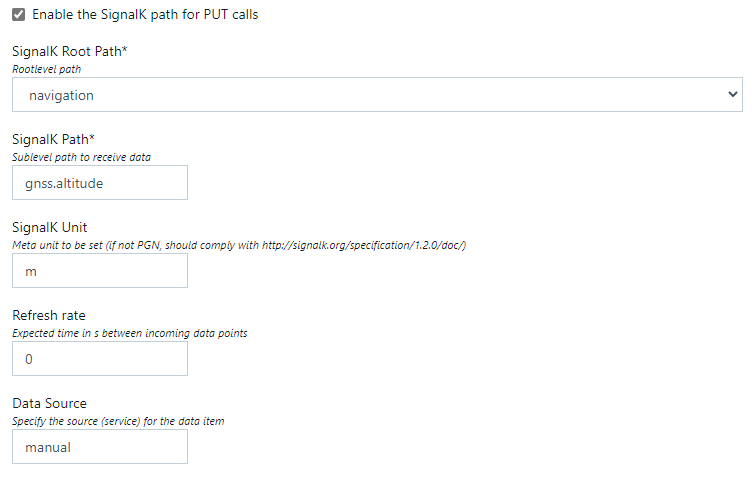
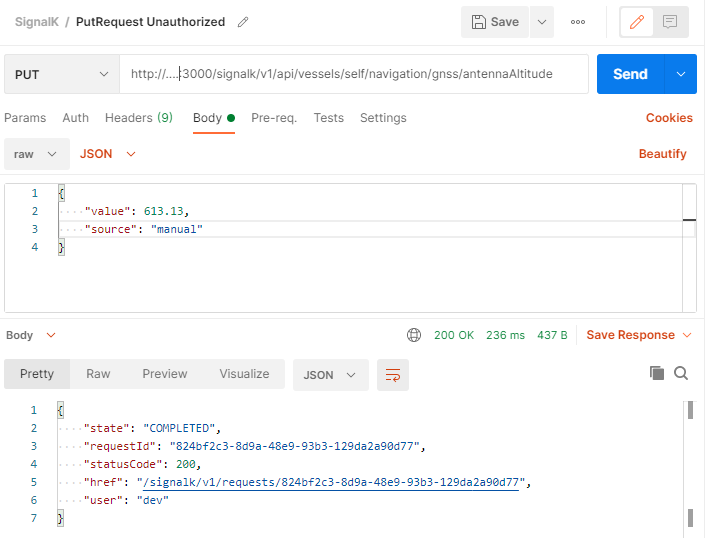

# signalk-rest-connector-plugin
SignalK plugin to receive selected deltas via REST PUT requests

## Install & Use
Install the plugin through the SignalK plugin interface, *Activate* it in the SignalK Plugin Config and add an
endpoint per SignalK path that shall receive values - the list is open ended, each path can be enabled or disabled.
The plugin status shows how many paths are configured and how many of them are active.

The plugin will inject new SignalK values, eg. `navigation.gnss.antennaAltitude`, by configuring like



- **Unit** - the SignalK unit of the path (published as meta `units`), or the unit the values are sent in. Values in
  km/h, kn, mph, Bft, °C, °F, °, hPa, mbar, kPa, inHg, mmHg, psi, km, nm (nautical miles), mi, ft, cm, %, l, gal,
  rpm, Ah, Wh, kWh, h or min are converted to their SignalK unit (eg. km/h → m/s) with the `skunits.js` shared by
  the Inspired Technologies plugins; the configuration form lists the conversions. Any other unit - SignalK units
  included - is published unchanged.
- **Refresh rate** - the expected time between values, published as meta `timeout`; 0 means no timeout.
- **Data Source** - the `source` a client names in its PUT request; several sources can update the same path.

### PUT requests

```
PUT /signalk/v1/api/vessels/self/<path with / instead of .>
{ "value": 1013.5, "source": "<Data Source>" }
```

The requests go to the SignalK API of the server, the OpenAPI description of the configured paths is in the
*Documentation* of the server admin UI. With security enabled, the request needs a token of a user or device
with **readwrite** (or admin) permission - readonly users are rejected, and the server's ACLs apply. This can
be done even manually through Postman:



A value that doesn't match the type of the current value of the path, or a value in a convertible unit that is no
number, is rejected with status 400.

## Development

Tests based on the built-in [`node:test`](https://nodejs.org/api/test.html) runner against a stubbed server app:

```sh
npm install
npm test
```

***

## Release Notes
See [Changelog](CHANGELOG.md).
